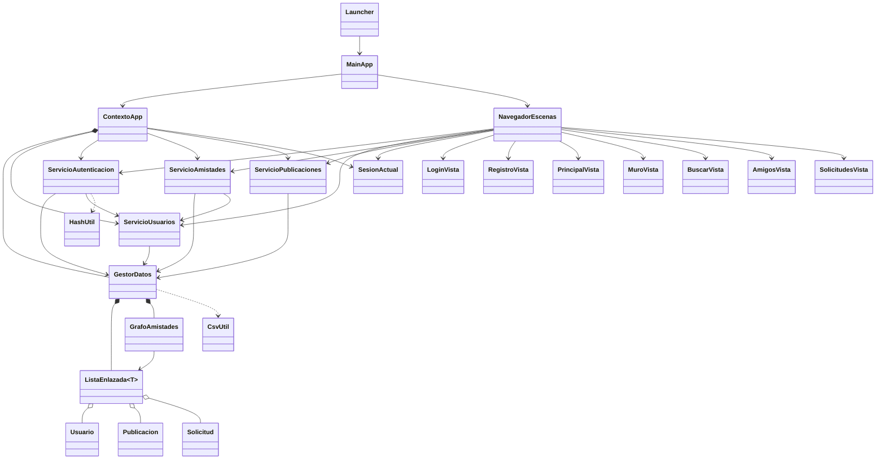

# Manual técnico — Social UNA

Documento de apoyo para la defensa. Explica cómo está organizado el proyecto,
qué hace cada módulo y cómo se conectan las piezas.

---

## 1. Arquitectura por capas

```
┌─────────────────────────────────────────────────────────────┐
│  VISTAS (JavaFX)                                            │
│  LoginVista · RegistroVista · PrincipalVista · MuroVista    │
│  BuscarVista · AmigosVista · SolicitudesVista               │
│  NavegadorEscenas (cambia de pantalla)                      │
└───────────────────────────┬─────────────────────────────────┘
                            │ reciben los servicios por constructor
┌───────────────────────────▼─────────────────────────────────┐
│  SERVICIOS (lógica de negocio)                              │
│  ServicioUsuarios · ServicioAutenticacion                   │
│  ServicioAmistades · ServicioPublicaciones · SesionActual   │
└───────────────────────────┬─────────────────────────────────┘
                            │ piden las estructuras a GestorDatos
┌───────────────────────────▼─────────────────────────────────┐
│  PERSISTENCIA                                               │
│  GestorDatos · RepositorioUsuarios · RepositorioAmistades   │
│  RepositorioSolicitudes · RepositorioPublicaciones          │
└───────────────────────────┬─────────────────────────────────┘
                            │ leen y escriben
┌───────────────────────────▼─────────────────────────────────┐
│  DATOS                                                      │
│  data/ (CSV de trabajo)  ←  datos_ejemplo/ (auto-seed)      │
└─────────────────────────────────────────────────────────────┘
```

Regla clave: **la vista nunca crea un servicio con `new`**. Todo llega por
constructor desde `ContextoApp`.

---

## 2. Diagrama de clases



---

## 3. Módulos y responsabilidades

### Modelo

| Clase | Qué representa |
|---|---|
| `Usuario` | Estudiante registrado: id, nombre, usuario y hash de contraseña. |
| `Publicacion` | Mensaje del muro: id, autor, fecha, contenido y si fue editada. |
| `Solicitud` | Solicitud de amistad pendiente: emisor, receptor y fecha. |
| `GrafoAmistades` | Grafo no dirigido con lista de adyacencia. |

### Utilidades

| Clase | Qué hace |
|---|---|
| `ListaEnlazada<T>` | Lista enlazada propia (agregar, buscar, filtrar, ordenar, iterar). |
| `Nodo<T>` | Nodo de la lista enlazada. |
| `HashUtil` | SHA-256 con salt aleatorio por usuario. |
| `CsvUtil` | Lectura y escritura CSV con comillas y escritura atómica. |
| `AlertaUtil` | Alertas y confirmaciones de JavaFX. |
| `Validador` | Validaciones de campos de la interfaz. |

### Persistencia

| Clase | Qué hace |
|---|---|
| `GestorDatos` | Dueño de las estructuras en memoria; carga, guarda y hace el auto-seed. |
| `RepositorioUsuarios` | Lee y escribe `usuarios.csv`. |
| `RepositorioAmistades` | Lee y escribe `amistades.csv`. |
| `RepositorioSolicitudes` | Lee y escribe `solicitudes.csv`. |
| `RepositorioPublicaciones` | Lee y escribe `publicaciones.csv`. |

### Servicios

| Clase | Qué hace |
|---|---|
| `ServicioUsuarios` | Listar, buscar por id, por usuario y por texto. |
| `ServicioAutenticacion` | Registro con validaciones y login con verificación de hash. |
| `ServicioAmistades` | Solicitudes, aceptar, rechazar, eliminar amigo y amigos en común. |
| `ServicioPublicaciones` | Publicar, editar, eliminar, feed y muro personal. |
| `SesionActual` | Guarda el usuario con la sesión abierta. |

### Vistas

| Clase | Qué hace |
|---|---|
| `NavegadorEscenas` | Cambia de pantalla y controla el acceso sin sesión. |
| `LoginVista` / `RegistroVista` | Entrada y alta de usuarios. |
| `PrincipalVista` | Menú principal con contadores. |
| `MuroVista` | Publicar, editar, borrar y ver el feed. |
| `BuscarVista` | Buscar usuarios y enviar solicitudes. |
| `AmigosVista` | Ver y eliminar amigos. |
| `SolicitudesVista` | Aceptar o rechazar solicitudes. |

---

## 4. Estructuras de datos propias

### Lista enlazada

Se usa para usuarios, publicaciones y solicitudes. Cada operación recorre los
nodos; no se usan `ArrayList` ni `LinkedList` de Java.

- `agregar` inserta al final.
- `agregarAlInicio` inserta al principio.
- `buscar` recorre hasta encontrar; devuelve `Optional`.
- `eliminarSi` recorre y borra todos los que cumplan la condición.
- `ordenar` ordena con el comparador que reciba.

### Grafo de amistades

- **No dirigido**: si A es amigo de B, B es amigo de A.
- Se guarda como **lista de adyacencia**: cada vértice tiene una lista de vecinos.
- No permite auto-amistades ni aristas duplicadas.
- `obtenerAristas` devuelve cada amistad una sola vez, como `[menor, mayor]`.
- `amigosEnComun(a, b)` compara las listas de vecinos de ambos.

---

## 5. Persistencia y auto-seed

Formato de los CSV (primera fila = encabezado):

```
usuarios.csv        id,nombre,usuario,contrasenaHash
amistades.csv       idUsuarioA,idUsuarioB
solicitudes.csv     idEmisor,idReceptor,fecha
publicaciones.csv   id,idAutor,fechaHora,contenido,editada
```

- Las fechas van en ISO-8601 (`2026-11-01T09:00`).
- Los campos con comas, comillas o saltos de línea se escriben entre comillas.
- Cada guardado escribe un `.tmp` y luego reemplaza el archivo (escritura atómica).
- Después de cada cambio, el servicio guarda el CSV que corresponda.

**Auto-seed:** al iniciar, `GestorDatos.cargarTodo()` revisa si `data/` tiene
usuarios. Si está vacía y existe `datos_ejemplo/` al lado, copia los cuatro CSV.
A partir de ahí, la app trabaja y guarda siempre sobre `data/`.

---

## 6. Seguridad de las contraseñas

- Se genera un **salt aleatorio de 16 bytes** con `SecureRandom` por usuario.
- El hash es **SHA-256** sobre `salt + contraseña`.
- Se guarda como `salt:hash` en hexadecimal, así entra en el CSV sin escapes.
- La verificación compara en **tiempo constante** (`MessageDigest.isEqual`).
- El login devuelve el mismo error para usuario inexistente y contraseña
  incorrecta: no revela qué usuarios existen.

---

## 7. Flujo de una amistad

```
1. Ana busca a Luis en BuscarVista.
2. ServicioAmistades.enviarSolicitud(ana, luis)
   → valida que no sean amigos, que no haya solicitud previa
   → guarda solicitudes.csv
3. Luis entra a SolicitudesVista y acepta.
4. ServicioAmistades.aceptar(ana, luis)
   → agrega la arista al grafo
   → borra la solicitud
   → guarda amistades.csv y solicitudes.csv
5. Desde ese momento el feed de Ana incluye las publicaciones de Luis.
```

---

## 8. Compilar y ejecutar

```bash
# Ejecutar desde Maven
mvn javafx:run

# Generar el .jar ejecutable
mvn clean package
java -jar target/social-una-1.0.0.jar
```

Requisitos: **JDK 24 o superior** (probado con JDK 26) y JavaFX 26.0.1.
